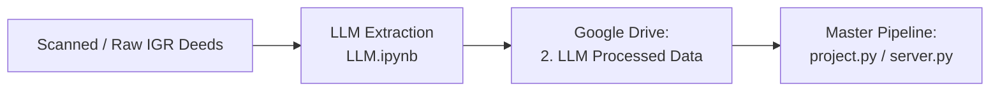

# Preprocessing & LLM Extraction Workflows

This directory houses research, exploration, and fine-tuning pipelines for parsing unstructured and semi-structured Inspector General of Registration (IGR) registration deeds using Large Language Models (LLMs) and heuristic extractors.

---

## 📁 Directory Contents

- **[`LLM.ipynb`](file:///e:/Nilesh/IGR_processing_System/Preprocessing_And_LLM/LLM.ipynb)**:
  - Notebook for evaluating, testing, and prompting LLMs (e.g., Gemini, GPT-4) on Marathi and English legal deed text.
  - Extracts structured entities: document number, registration date, party names (seller/purchaser), consideration amount, market value, property details, and area clauses.
  - Generates the semi-structured JSON/dictionary outputs that feed into Step 1 and Step 2 (`DictToColumn.py`) of the main processing pipeline.

- **[`igr_preprocessing.ipynb`](file:///e:/Nilesh/IGR_processing_System/Preprocessing_And_LLM/igr_preprocessing.ipynb)**:
  - Notebook for early-stage data cleaning, OCR text normalization, Marathi string preprocessing, and dictionary column validation.
  - Explores patterns for resolving Marathi revenue village names and boundary descriptions.

---

## 🔄 Relationship to the Master Pipeline

Outputs produced by LLM extraction runs are saved to the Google Drive folder **`2. LLM Processed Data`**, which serves as the entry point for **Step 1** of `project.py`.
