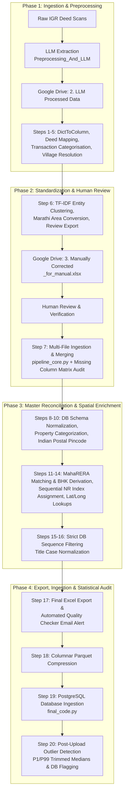

# IGR & Real Estate Data Processing System

[](https://www.python.org/downloads/)
[](https://www.postgresql.org/)
[](file:///e:/Nilesh/IGR_processing_System/Processing/server.py)
[]()

An enterprise-grade, end-to-end data engineering and analytics pipeline for ingesting, standardizing, enriching, verifying, and uploading real estate transaction datasets. The system natively handles domestic Indian Inspector General of Registration (**IGR**) registration deeds (Maharashtra: Pune, Mumbai, Thane) and international real estate transaction portals (Middle East: **Dubai Land Department**, Abu Dhabi).

---

## 📑 Table of Contents

- [1. System Architecture & Overview](#1-system-architecture--overview)
- [2. Repository Structure](#2-repository-structure)
- [3. End-to-End Pipeline Flow (Steps 1 to 20)](#3-end-to-end-pipeline-flow-steps-1-to-20)
- [4. Multi-File Merging & Quality Audit (Step 7 Engine)](#4-multi-file-merging--quality-audit-step-7-engine)
- [5. Statistical Outlier Detection System (Step 20)](#5-statistical-outlier-detection-system-step-20)
- [6. Dubai Land Department (DLD) Pipeline](#6-dubai-land-department-dld-pipeline)
- [7. Web Operations Dashboard & SSE Streaming](#7-web-operations-dashboard--sse-streaming)
- [8. Execution Modes & CLI Reference](#8-execution-modes--cli-reference)
- [9. Configuration & Google Drive Integration](#9-configuration--google-drive-integration)
- [10. Setup & Installation](#10-setup--installation)

---

## 1. System Architecture & Overview

The system automates the ingestion of semi-structured LLM extractions from raw Marathi legal documents, resolves real estate entities using character n-gram TF-IDF clustering, parses regional Marathi land measurement units (Hectare, Are, Guntha, Sq.m, Sq.ft), manages human review verification, reconciles against MahaRERA master records, allocates sequential project tracking indexes, compresses datasets into Parquet format, bulk-loads data into PostgreSQL, and executes post-upload statistical outlier classification.



---

## 2. Repository Structure

```
IGR_processing_System/
├── README.md                                  # 📖 Master system documentation
├── Outlier_Detection_Update_documentaion.pdf  # 📄 Outlier detection mathematical specification
├── .gitignore                                 # 🙈 Git ignore rules
│
├── Processing/                                # 🚀 Core processing pipeline & Web server
│   ├── project.py                             # Master CLI pipeline orchestrator (Steps 1 to 20)
│   ├── server.py                              # FastAPI/HTTP server with real-time SSE streaming
│   ├── pipeline_core.py                       # Shared engine: DB connections, Step 7 multi-merger, schema
│   ├── city_config.py                         # Multi-city metadata, Google Drive IDs, RERA paths, emails
│   ├── divisor.py                             # City carpet area divisors (Mumbai: 1.45, Pune: 1.35, etc.)
│   ├── db_columns.py                          # Canonical PostgreSQL schema column sequence (DB_SEQUENCE)
│   ├── DictToColumn.py                        # Stringified JSON/dict extractor
│   ├── static.py                              # Marathi deed name lookup & word number mappings
│   ├── transaction_categorizer.py             # Categorizes transactions into Sale / Lease / Other
│   ├── project_name_Std_and_area_conversion.py# TF-IDF clustering, Marathi area converter, review exporter
│   ├── rera_matching.py                       # MahaRERA fuzzy matching engine with BHK configuration
│   ├── postal_pincode.csv                     # Master Indian postal PIN code database
│   ├── parquet_conersion.py                   # High-performance Parquet converter with overflow protection
│   ├── outlier_update.py                      # Statistical outlier detection engine with DB writeback
│   ├── generate_pdf_doc.py                    # Programmatic ReportLab PDF documentation builder
│   ├── PIPELINE_DOCUMENTATION.md              # Detailed technical pipeline manual
│   ├── PIPELINE_DOCUMENTATION.pdf              # Compiled PDF documentation manual
│   │
│   ├── web/                                   # 💻 Web Operations Dashboard
│   │   ├── index.html                         # Operations web interface
│   │   ├── app.js                             # SSE client, dynamic stage router, multi-file selector
│   │   ├── style.css                          # Modern dark-themed responsive stylesheet
│   │   └── email_template.html                # HTML template for automated review alerts
│   │
│   └── Dubai_processing/                     # 🏙️ Middle East pipeline automation
│       ├── README.md                          # Dubai pipeline guide
│       ├── dubai_scraper.py                   # Automated Selenium scraper for DLD portal
│       ├── dld_pipeline.py                    # Complete DLD cleaning, coordinate lookup & NR indexing
│       ├── project_coordinates.ipynb          # Dubai geospatial research notebook
│       └── requirements.txt                   # Scraper dependencies
│
├── Preprocessing_And_LLM/                     # 🧠 LLM extraction research & deed preprocessing
│   ├── README.md                              # Sub-module documentation
│   ├── LLM.ipynb                              # Prompts, entity parsing tests, and raw JSON generators
│   └── igr_preprocessing.ipynb                # OCR text cleaning and Marathi token normalizers
│
└── outlier_implementaion/                     # 📊 Standalone statistical outlier scripts
    ├── README.md                              # Mathematical formula and usage manual
    └── outlier_update.py                      # Standalone SQL/Pandas trimmed median updater
```

---

## 3. End-to-End Pipeline Flow (Steps 1 to 20)

| Step | Name | Primary Module / Function | Description |
| :---: | :--- | :--- | :--- |
| **0** | **City & Target Selection** | [city_config.py](file:///e:/Nilesh/IGR_processing_System/Processing/city_config.py) | Dynamic resolution of city ID, Google Drive IDs, divisors, and RERA reference files. |
| **1** | **Input File Discovery** | `get_file_from_drive()` | Scans `2. LLM Processed Data` on Google Drive, categorizes files by locality, and selects input. |
| **2** | **DictToColumn Parsing** | [DictToColumn.py](file:///e:/Nilesh/IGR_processing_System/Processing/DictToColumn.py) | Parses stringified JSON / nested dictionaries from LLM outputs into tabular DataFrame columns. |
| **3** | **Project Name Initialization** | `project.py` | Sets `final_project_name` prioritizing `project_name_en` with fallback to `building_name_en`. |
| **4** | **Marathi Deed Translation** | [static.py](file:///e:/Nilesh/IGR_processing_System/Processing/static.py) | Translates Marathi deed names (`खरेदीखत`, `भाडेपट्टा`, `बक्षीसपत्र`, etc.) to standardized English types. |
| **5** | **Transaction Categorization** | [transaction_categorizer.py](file:///e:/Nilesh/IGR_processing_System/Processing/transaction_categorizer.py) | Categorizes deeds into analytical buckets: `Sale`, `Lease / Mortgage`, or `Other`. |
| **5.5** | **Marathi Village Mapping** | `populate_village_mapping()` | Matches Marathi revenue village (`village_name_marathi` / `areaname`) against PostgreSQL database. |
| **6** | **Clustering & Area Conversion** | [project_name_Std_and_area_conversion.py](file:///e:/Nilesh/IGR_processing_System/Processing/project_name_Std_and_area_conversion.py) | Applies TF-IDF n-gram clustering, converts Marathi area expressions to sq.m, calculates carpet area using city divisors, flags `is_manual_processed`, and exports `<Loc>_for_manual.xlsx`. |
| **7** | **Multi-File Reviewed File Load** | [pipeline_core.py](file:///e:/Nilesh/IGR_processing_System/Processing/pipeline_core.py) (`load_and_merge_step7_files`) | Pauses for human review. Ingests single, multiple, or all corrected files, performs column validation, creates `Step7_Missing_Columns_Report.xlsx`, and merges into `final merge file.xlsx`. |
| **8** | **Database Schema Normalization** | [pipeline_core.py](file:///e:/Nilesh/IGR_processing_System/Processing/pipeline_core.py) (`rename_columns`) | Maps raw columns to official PostgreSQL schema (`docno` -> `document_number`, `consideration_amt` -> `agreement_price`, etc.). |
| **9** | **Property Type Categorization** | `_map_property_type()` | Maps raw types into standard taxonomy: `Flat`, `Office`, `Shop`, `Villa`, `Plot`, `Others`. |
| **10** | **Buyer Pincode Enrichment** | `add_buyer_location()` | Extracts 6-digit Indian PIN codes from party text and merges against [postal_pincode.csv](file:///e:/Nilesh/IGR_processing_System/Processing/postal_pincode.csv). |
| **11** | **MahaRERA Master Matching** | [rera_matching.py](file:///e:/Nilesh/IGR_processing_System/Processing/rera_matching.py) | Fuzzy matches project names against verified RERA datasets; enriches RERA index, coordinates, registered location, and derives BHK unit configurations. |
| **12** | **Sequential NR Indexing** | [pipeline_core.py](file:///e:/Nilesh/IGR_processing_System/Processing/pipeline_core.py) (`assign_nr_indexes`) | Assigns sequential tracking IDs (`nr18421`, `nr18422`, ...) for non-RERA projects via PostgreSQL. |
| **13** | **Location Coordinate Fallback** | [pipeline_core.py](file:///e:/Nilesh/IGR_processing_System/Processing/pipeline_core.py) (`populate_location_coords`) | Fetches regional coordinates from `public.dim_location` when project coordinates are unavailable. |
| **14** | **Project Coordinates Enrichment** | `project_coordinates.py` | Google Places API geocoding enrichment (toggleable to manage API consumption). |
| **15** | **Strict Schema Sequence Filter** | [db_columns.py](file:///e:/Nilesh/IGR_processing_System/Processing/db_columns.py) (`DB_SEQUENCE`) | Filters and reorders DataFrame columns to match `public.transactions` in PostgreSQL exactly. |
| **16** | **Cosmetic Title Casing** | `project.py` | Normalizes text casing across all string columns for visual and reporting consistency. |
| **17** | **Final Export & Checker Alert** | `project.py` / [city_config.py](file:///e:/Nilesh/IGR_processing_System/Processing/city_config.py) | Writes `<Loc>_final_processed.xlsx` to Google Drive `4. Final processed file` and automatically dispatches quality review notification email to `deeksha@sigmavalue.co.in`. |
| **18** | **Columnar Parquet Conversion** | [parquet_conersion.py](file:///e:/Nilesh/IGR_processing_System/Processing/parquet_conersion.py) | Generates compressed Parquet file with date overflow protection for rapid database ingestion. |
| **19** | **PostgreSQL Ingestion Trigger** | `final_code.py` | Executes database loader subprocess to bulk insert transactions into PostgreSQL. |
| **20** | **Statistical Outlier Detection** | [outlier_update.py](file:///e:/Nilesh/IGR_processing_System/Processing/outlier_update.py) | Computes trimmed medians (P1/P99), identifies price boundaries, and batch updates `rate`, `is_outlier`, and `outlier_type` in PostgreSQL. |

---

## 4. Multi-File Merging & Quality Audit (Step 7 Engine)

The pipeline incorporates a robust multi-file merging engine in `pipeline_core.py` (`load_and_merge_step7_files`):

- **Flexible File Input**: Supports a single file, multiple comma-separated files (e.g., `1,2,3`), or `all` files in a reviewed directory.
- **Automated Column Harmonization**: Maps aliases such as `flat_no` -> `flat_no_raw` and `floor_no` -> `floor_no_raw` before unioning.
- **Missing Column Audit Reports**:
  - Compares columns in each individual file against the union of all files.
  - Automatically exports a 3-sheet Excel workbook: **`Step7_Missing_Columns_Report.xlsx`**:
    1. **Summary Sheet**: File-by-file metrics (row counts, present columns, missing column count and list).
    2. **Column Matrix Sheet**: Cross-tabulation table indicating presence or absence for every column across all files.
    3. **Missing Columns Detail Sheet**: Granular row-by-row listing of missing column occurrences.
  - Exports a CSV fallback matrix: **`Step7_Missing_Columns_Matrix.csv`**.
- **Auto-Saved Merged Master Dataset**:
  - Automatically saves the unified dataset to `Google Drive: 3. Manually Corrected / FINAL MERGE / final merge file.xlsx`.
- **Systematic Column Stripping**:
  - Strips over 100 internal helper and temporary columns (e.g., `society_name_en`, `cluster_min_confidence_score`, `FLAT AREAS`, `AREA DETAILS_*`) to preserve clean database-ready schemas.

---

## 5. Statistical Outlier Detection System (Step 20)

Statistical outlier detection is executed directly against PostgreSQL records to protect analytical dashboards:

### Mathematical Model:
1. **Rate Derivation**:
   $$\text{calc\_rate} = \frac{\text{agreement\_price}}{\text{net\_carpet\_area\_sq\_m} \times 10.764}$$
2. **Stratification & Grouping**:
   Records are grouped by `(city, location, transaction_category, property_type)`.
   - International markets (`dubai`, `abu_dhabi`) have localities collapsed into `__ALL_LOCATIONS__` to ensure sufficient statistical sample sizes.
3. **Percentile Trimming**:
   The top 1% and bottom 1% ($P_{1}$ and $P_{99}$) of records within each group are excluded to remove extreme distortions.
4. **Trimmed Median & Boundary Computation**:
   $$\text{lower\_limit} = \frac{\text{median}_{\text{trimmed}}}{4}, \quad \text{upper\_limit} = \text{median}_{\text{trimmed}} \times 4$$
5. **Classification Rules**:
   - **`Mumbai Zero Area & Rate - Not Outlier`**: Exemption where rate, area, or price is 0 in Mumbai (`is_outlier = False`).
   - **`Mumbai Low Price Outlier (Sale < 1L)`**: Sale transactions with agreement price under ₹100,000 (`is_outlier = True`).
   - **`Lower Outlier`**: $\text{calc\_rate} < \text{lower\_limit}$.
   - **`Upper Outlier`**: $\text{calc\_rate} > \text{upper\_limit}$.
   - **`Normal`**: Transaction rate falls within $[\text{lower\_limit}, \text{upper\_limit}]$.
   - **`Invalid/Excluded`**: Zero or negative price/area values.
6. **Batched Database Update**:
   Executes high-speed batch updates using `psycopg2.extras.execute_values` on `public.transactions`, writing `rate`, `is_outlier`, and `outlier_type`.

---

## 6. Dubai Land Department (DLD) Pipeline

A dedicated automated pipeline for international Middle Eastern real estate data is maintained in [`Processing/Dubai_processing/`](file:///e:/Nilesh/IGR_processing_System/Processing/Dubai_processing):

1. **Automated Selenium Scraper (`dubai_scraper.py`)**:
   - Interacts with the DLD Open Data Portal.
   - Automatically queries `public.transactions` for the last recorded transaction date to scrape only fresh incremental data.
   - Handles Google reCAPTCHA challenges automatically.
   - Supports headless execution and automatic upload to Google Drive.
2. **End-to-End Processing & NR Allocation (`dld_pipeline.py`)**:
   - Ingests raw DLD CSV files, strips duplicates, and standardizes date representations into quarterly format.
   - Enriches records with PostgreSQL spatial coordinates and project IDs (`dim_project`, `dim_location`).
   - Allocates sequential NR index IDs (`nrXXXX`) scoped to Dubai (`city_id = 15`).
   - Produces clean database-ready output files.

---

## 7. Web Operations Dashboard & SSE Streaming

In addition to the CLI, an interactive, browser-based management interface is provided via `Processing/server.py` and `Processing/web/`:

- **Real-Time Streaming**: Uses Server-Sent Events (**SSE**) at `/api/status` to stream terminal output, step progressions, and metrics directly to the browser.
- **Dynamic Multi-City Selector**: Dynamically switches configurations across Pune, Mumbai, Thane, Dubai, Abu Dhabi, etc.
- **Multi-File Review Selector**: Select multiple review files directly from the browser UI with instant merge audit feedback.
- **Active Database Switcher**: Switch the active target PostgreSQL database (`/api/set-db`) on the fly.
- **Full Execution Controls**: Trigger full pipeline runs, resume from Step 7, trigger Parquet conversion, run outlier updates, or safely terminate active background threads.

To start the Web Dashboard:
```bash
cd Processing
python server.py
# Dashboard opens automatically at http://localhost:8000
```

---

## 8. Execution Modes & CLI Reference

Launch `project.py` from the command line:

```bash
cd Processing
python project.py
```

### CLI Menu Options:
```
[1] Run from START (Step 1 to Step 20)
    - Full end-to-end execution: LLM ingestion -> clustering -> pause at Step 6 ->
      resumes at Step 7 -> RERA matching -> NR indexing -> Parquet -> DB upload -> Outliers.

[2] Run from STEP 7 (Load manually corrected file directly, Steps 7 to 20)
    - Resumes pipeline immediately after human review of project names.
    - Prompts for single, multiple, or all corrected files, performs multi-file merge,
      generates missing columns report, and continues through to upload and outlier detection.

[3] Run STEP 18 ONLY (Parquet Conversion directly)
    - Fast conversion of verified final processed Excel/CSV files into columnar Parquet format.
    - Automatically chains into Step 19 (DB Upload) and Step 20 (Outlier Detection).

[4] Run STEP 20 ONLY (Outlier Update directly)
    - Standalone statistical outlier detection and classification directly on PostgreSQL.
    - Computes trimmed medians and writes outlier flags without modifying data files.
```

For **Dubai** (City ID 15), `project.py` automatically presents the dedicated Dubai workflow:
```
[1] Run FULL Workflow (Step 1: Scraping ➔ Step 2: Processing)
[2] Run Step 1 ONLY: Scraping (dubai_scraper.py)
[3] Run Step 2 ONLY: Processing (dld_pipeline.py)
```

---

## 9. Configuration & Google Drive Integration

### Central Configuration (`Processing/city_config.py`):
- **City IDs**: Resolves database city keys (`pune`: 9, `mumbai`: 8, `thane`: 12, `dubai`: 15, `abu_dhabi`: 1).
- **Divisors (`divisor.py`)**: Saleable-to-carpet ratios (Mumbai: `1.45`, Pune: `1.35`, Thane: `1.40`, Dubai: `1.0`).
- **Google Drive Shortcut Binding**:
  - Dynamically binds local Google Drive Desktop sync folders located under `G:\.shortcut-targets-by-id\<folder_id>\` without requiring OAuth tokens during local execution:
    - `2. LLM Processed Data` (Raw inputs)
    - `3. Manually Corrected` (Human review files)
    - `4. Final processed file` (Final verified outputs)
- **Quality Checker Notifications**: Dispatches automated HTML alerts upon final file creation to `deeksha@sigmavalue.co.in`.

---

## 10. Setup & Installation

### Prerequisites:
- Python 3.10 or higher
- PostgreSQL 14+ with PostGIS / real estate schema (`transactions`, `dim_project`, `dim_location`, `dim_city`)
- Google Drive Desktop mounted at `G:\`
- Google Chrome & ChromeDriver (for Dubai web scraping)

### Installation:
```bash
# Clone the repository
git clone https://github.com/Nilesh-DataAnalyst/IGR_Processing_System.git
cd IGR_Processing_System

# Create and activate virtual environment
python -m venv venv
# Windows:
.\venv\Scripts\activate

# Install dependencies
pip install -r Processing/Dubai_processing/requirements.txt
pip install pandas numpy psycopg2-binary openpyxl xlsxwriter pyarrow fastparquet scikit-learn reportlab selenium requests
```

### Environment Configuration:
Create a `.env` file in the root directory:
```env
DB_HOST=localhost
DB_PORT=5432
DB_NAME=nilesh
DB_USER=postgres
DB_PASSWORD=your_password
SMTP_EMAIL=your_email@sigmavalue.co.in
SMTP_PASSWORD=your_app_password
```

---

## 👥 Contributors & Quality Assurance
- **Core Engineering & Data Pipeline**: Nilesh ([nilesh@sigmavalue.co.in](mailto:nilesh@sigmavalue.co.in))
- **Quality Assurance & Verification**: Deeksha ([deeksha@sigmavalue.co.in](mailto:deeksha@sigmavalue.co.in))
